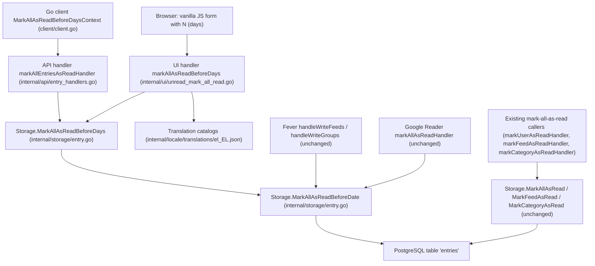
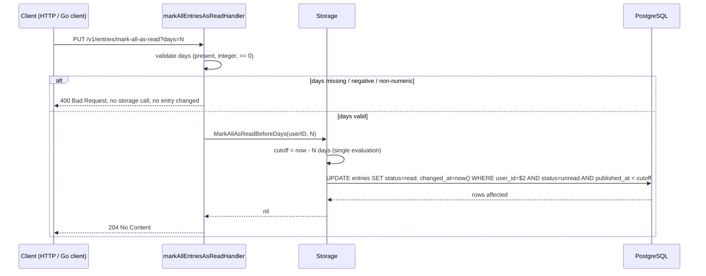

# Plan

Implement the age-based bulk read-marking by reusing the existing storage primitive `MarkAllAsReadBeforeDate` (`internal/storage/entry.go:523-544`), whose SQL already applies the exact semantics the spec demands (`WHERE user_id=$2 AND status=$3 AND published_at < $4` — per-user, unread-only, strictly-before cut-off). The only genuinely new work is: (a) a thin day→cut-off seam beside that function, (b) an API entry point that accepts and validates `N`, (c) a UI action in `internal/ui/unread_mark_all_read.go` (beside `markAllAsRead` at `internal/ui/unread_mark_all_read.go:13-20`) whose label resolves from the translation catalogs (`internal/locale/translations/el_EL.json`), and (d) an optional convenience method in `client/client.go` beside `MarkAllAsRead` (`client/client.go:327-331`). Existing read-marking surfaces are deliberately untouched: `markUserAsReadHandler` (`internal/api/user_handlers.go:132`), `markFeedAsReadHandler` (`internal/api/feed_handlers.go:162`), `markCategoryAsReadHandler` (`internal/api/category_handlers.go:104`), and the Fever write path `handleWriteFeeds`/`handleWriteGroups` (`internal/fever/handler.go:481-502`, `:510-541`) keep their current parameters and responses, so the Fever `before` contract and `MarkAllAsRead`/`MarkFeedAsRead`/`MarkCategoryAsRead` callers are unaffected. No schema change is required: the change writes no new column and reads no new column — the `entries` table (defined in `internal/database/migrations.go`) and its writers (`SetEntriesStatus`, `SetEntriesStatusAndCountVisible`, `MarkAllAsRead`, `MarkFeedAsRead`, `MarkCategoryAsRead`, `ArchiveEntries`, `FlushHistory`, `ToggleStarred`) are all unaffected.

Existing capability: MarkAllAsReadBeforeDate at internal/storage/entry.go:523-544

## Components

- **MarkAllAsReadBeforeDate** *(reused, unchanged)* — **Extends** `internal/storage/entry.go` (`MarkAllAsReadBeforeDate`, internal/storage/entry.go:523-544). No delta to its SQL. It already provides the required semantics: `status=$3` filters to unread so already-read entries are untouched and `RowsAffected` is 0 (AC-5), `published_at < $4` gives the strict "older than" boundary (AC-4), `user_id=$2` gives per-user isolation (AC-10), and an open lower bound makes `N = 0` mark the whole current backlog (AC-6, AC-2, AC-3). (satisfies: AC-2, AC-3, AC-4, AC-5, AC-6, AC-10)

- **MarkAllAsReadBeforeDays** — **New** — `func (s *Storage) MarkAllAsReadBeforeDays(userID int64, days int) error`, placed in `internal/storage/entry.go` beside `MarkAllAsReadBeforeDate`. It computes a single cut-off `time.Now().AddDate(0, 0, -days)` and delegates to `MarkAllAsReadBeforeDate`. **New because**: the closest existing symbols (`MarkAllAsReadBeforeDate` at internal/storage/entry.go:523-544, and the sibling `MarkAllAsRead` at internal/storage/entry.go:506-520) already take a fully-computed `time.Time`/no bound; no retrieved symbol in `internal/storage/entry.go` converts a day count, and computing the cut-off once at a single seam is what makes the AC-4 boundary deterministic and unit-testable. (satisfies: AC-1, AC-2, AC-6)

- **markAllEntriesAsReadHandler** — **New function in an existing file** — **Extends** `internal/api/entry_handlers.go` (same package as `flushHistoryHandler` at internal/api/entry_handlers.go:556). Reads the required `days` query parameter, rejects a missing, non-numeric, or negative value with the existing JSON bad-request response and no storage call (AC-7), otherwise calls `MarkAllAsReadBeforeDays` and returns the same success status the existing mark-as-read endpoints use. (satisfies: AC-1, AC-7, AC-11)

- **REST route** `PUT /v1/entries/mark-all-as-read` — **New** — additive route for the age-bounded operation, chosen as a new route rather than an extra parameter on the existing user/feed mark-all-as-read operations so that those documented contracts (and their `204 No Content` responses) are byte-for-byte unchanged (AC-8). The router/registration file is **not in the retrieved context** — the route string and its registration point must be confirmed against the server routing package before implementation. (satisfies: AC-1, AC-7, AC-8)

- **markAllAsReadBeforeDays (UI handler)** — **New function in an existing file** — **Extends** `internal/ui/unread_mark_all_read.go` (beside `markAllAsRead` at internal/ui/unread_mark_all_read.go:13-20). Exposes the action to the web UI and calls `MarkAllAsReadBeforeDays`. It deliberately uses the user-scoped `MarkAllAsReadBeforeDays` → `MarkAllAsReadBeforeDate` path rather than the existing UI handler's `MarkGloballyVisibleFeedsAsRead`, because AC-6 requires *no* entry belonging to the user to remain unread, including entries of feeds/categories hidden globally. The template/markup and the client-side vanilla-JS affordance live in files **not in the retrieved context**; only a small native form/JS handler is needed and no framework is introduced. (satisfies: AC-1, AC-6, AC-11, AC-12)

- **Go client method** — **New** — `MarkAllAsReadBeforeDaysContext` plus a `MarkAllAsReadBeforeDays` wrapper in `client/client.go`, modelled on the sibling `MarkAllAsReadContext`/`MarkAllAsRead` (`client/client.go:327-331`, `client/client.go:334-337`). **New because** no existing client method carries an age parameter; the closest is `MarkAllAsRead` which sends no bound. The Python client is **not in the retrieved context**, so its counterpart (if any) cannot be located from the retrieved material and must be handled separately. (satisfies: AC-1, AC-11)

- **Translation catalog entries** — **Extends** `internal/locale/translations/el_EL.json` (and the sibling catalog files) — add keys for the action label, the `N`-days input, and the success/failure messages, so no user-facing string is hardcoded. (satisfies: AC-12)

- **Unchanged existing surfaces (explicitly out of the change)** — the Fever write path `handleWriteFeeds` (`internal/fever/handler.go:481-502`) and `handleWriteGroups` (`internal/fever/handler.go:510-541`), the Google Reader `markAllAsReadHandler` (`internal/googlereader/handler.go:1205`), and the API handlers `markUserAsReadHandler` (`internal/api/user_handlers.go:132`), `markFeedAsReadHandler` (`internal/api/feed_handlers.go:162`), `markCategoryAsReadHandler` (`internal/api/category_handlers.go:104`) keep their signatures, parameters and responses; they are the callers that prove AC-8 and AC-9. (satisfies: AC-8, AC-9)

## Architecture diagram



## Sequence diagrams



```mermaid
sequenceDiagram
  participant B as Browser (vanilla JS)
  participant U as UI markAllAsReadBeforeDays handler
  participant T as Translation catalog
  participant S as Storage
  participant DB as PostgreSQL
  B->>U: action submitted with N days
  U->>T: resolve action label / messages for request locale
  T-->>U: localized strings
  U->>S: MarkAllAsReadBeforeDays(userID, N)
  S->>DB: UPDATE entries ... AND status=unread AND published_at < cutoff
  DB-->>S: rows affected
  S-->>U: nil
  U-->>B: OK; unread view re-rendered from existing reporting surfaces
```

## ADRs

- **Decision**: Reuse `MarkAllAsReadBeforeDate` (`internal/storage/entry.go:523-544`) unchanged and add only a day→cut-off seam (`MarkAllAsReadBeforeDays`) beside it, instead of writing new SQL. **Rationale**: the existing statement already encodes the unread filter, the per-user predicate and the strict `<` boundary; new SQL would duplicate it and risk divergence, violating the "PostgreSQL without an ORM/one ordered migration track" constraint. (satisfies: AC-2, AC-3, AC-4, AC-5, AC-10)

- **Decision**: Compute the cut-off once per request as `time.Now().AddDate(0, 0, -days)` in Go and pass a `time.Time` down, rather than expressing the interval in SQL. **Rationale**: a single evaluation point makes the strict "exactly N days old is not older than N days" rule deterministic and unit-testable, and keeps the interval arithmetic out of the database layer, so no migration is needed. (satisfies: AC-4, AC-6)

- **Decision**: Treat `N = 0` as valid and reject negative or non-numeric `N` with a bad-request and **no** storage call. **Rationale**: `N = 0` must clear the whole current backlog (equivalent to the unfiltered operation), while AC-7 forbids any partial change on an invalid request — validation must therefore precede the single `UPDATE`. (satisfies: AC-1, AC-6, AC-7)

- **Decision**: Add a new REST route instead of extending the parameter set of the existing user/feed mark-all-as-read operations. **Rationale**: those operations are documented backward-compatible contracts; an additive route leaves their request/response shape untouched and guarantees AC-8 without argument. (satisfies: AC-8, AC-1)

- **Decision**: The web-UI age action calls `MarkAllAsReadBeforeDate` (all of the user's entries), not the `MarkGloballyVisibleFeedsAsRead` path used by the existing UI mark-all-as-read handler (`internal/ui/unread_mark_all_read.go:13-20`). **Rationale**: AC-6 requires that no entry belonging to the user remains unread after an `N = 0` run; the globally-visible variant deliberately skips hidden feeds/categories. (satisfies: AC-6, AC-10, AC-11)

- **Decision**: Leave the Fever `before` semantics and every existing read-marking caller untouched; add the day-based capability only on the new API route, the UI action, and a new optional client method. **Rationale**: the Fever and Google Reader APIs are contracts for existing mobile clients, and `MarkAllAsRead`/`MarkFeedAsRead`/`MarkCategoryAsRead` are already invoked from `internal/api/user_handlers.go:132`, `internal/api/feed_handlers.go:162`, `internal/api/category_handlers.go:104`, `internal/fever/handler.go:496`, `:521`, `:527`, `internal/googlereader/handler.go:1205` and `client/client.go:327-331`, `:749-753` — none may change behaviour. (satisfies: AC-8, AC-9)

- **Decision**: Route all new user-facing text through the translation catalogs (e.g. `internal/locale/translations/el_EL.json`) instead of literals in the handler or template. **Rationale**: the constitution requires localized user-facing text, and AC-12 is verified by resolving the label from a non-default locale. (satisfies: AC-12)

- **Decision**: Add a Go client helper next to `MarkAllAsRead` (`client/client.go:327-331`) rather than introducing a new client type or dependency. **Rationale**: the client library is a backward-compatible contract; an additive method preserves it while keeping the client surface consistent. (satisfies: AC-1, AC-11)

## Risks & mitigations

- **Risk**: Clock drift or the boundary instant makes an entry published "exactly N days ago" fall on either side of `<`. **Mitigation**: compute the cut-off once per request and rely on the existing strict `<` predicate; cover the boundary explicitly in tests at the storage level (AC-4). This is also the reason interval arithmetic is kept in Go (see ADR on the cut-off).
- **Risk**: The router/registration file for the new route `PUT /v1/entries/mark-all-as-read` is **not in the retrieved context**, so the exact path string could be wrong. **Mitigation**: confirm the path and registration point in the server routing package before implementing; the handler itself lives in `internal/api/entry_handlers.go`, which is in the retrieved context.
- **Risk**: Regression in existing read-marking paths. The affected callers are `markUserAsReadHandler` (`internal/api/user_handlers.go:132`), `markFeedAsReadHandler` (`internal/api/feed_handlers.go:162`), `markCategoryAsReadHandler` (`internal/api/category_handlers.go:104`), `handleWriteFeeds` (`internal/fever/handler.go:496`), `handleWriteGroups` (`internal/fever/handler.go:521`, `:527`), `markAllAsReadHandler` (`internal/googlereader/handler.go:1205`), `MarkAllAsRead` and `MarkFeedAsRead` in `client/client.go:327-331` and `:749-753`, and `markAllAsRead` in `internal/ui/unread_mark_all_read.go:13-20`. **Mitigation**: change none of them; add tests asserting the existing unfiltered and Fever `before` behaviours are unchanged (AC-8, AC-9).
- **Risk**: The retrieved context lists no caller for `MarkAllAsReadBeforeDate` itself, so its current wiring is unknown. **Mitigation**: do not assume it is called by anything; reuse it as a delegate only, and let the new `MarkAllAsReadBeforeDays` be its caller. Do not claim the function is unused — the retrieved context simply does not show its callers.
- **Risk**: The new UI action reaches entries of feeds/categories hidden globally, differing from the existing UI mark-all-as-read behaviour. **Mitigation**: intentional per AC-6/AC-10; call the divergence out in the UI copy and cover it with an integration test.
- **Risk**: Missing translation keys fall back to a hardcoded default in a non-default locale. **Mitigation**: add the keys to every catalog, including `internal/locale/translations/el_EL.json`, and test locale resolution (AC-12).
- **Risk**: Bulk update cost on very large backlogs. **Mitigation**: the operation is a single set-based `UPDATE ... WHERE user_id AND status AND published_at < cutoff` on the existing `entries` predicates; no per-row loop and no fan-out crawler work is triggered (Frugal Resource Usage).
- **Risk**: The Python client counterpart cannot be located from the retrieved context. **Mitigation**: implement the Go client helper beside `MarkAllAsRead` (`client/client.go:327-331`) and note the Python surface as a follow-up that must be located in the repository rather than invented.
- **Risk**: Accidental schema or writer churn. **Mitigation**: the change adds no stored column and reads no new column, so `internal/database/migrations.go` (defining table `entries`) needs no migration, and the writers `SetEntriesStatus`, `SetEntriesStatusAndCountVisible`, `ToggleStarred`, `SetEntriesStarredState`, `MarkAllAsRead`, `MarkAllAsReadBeforeDate`, `MarkGloballyVisibleFeedsAsRead`, `MarkFeedAsRead`, `MarkCategoryAsRead`, `ArchiveEntries`, `FlushHistory`, `EntryShareCode`/`UnshareEntry`, `createEntry`, `updateEntry`, `UpdateEntryTitleAndContent` are all untouched. Callers of unrelated retrieved symbols (`flushHistoryHandler` at `internal/api/entry_handlers.go:556`, `configureFilters` at `internal/api/entry_handlers.go:586`, `runCleanupTasks` at `internal/cli/cleanup_tasks.go:26`/`:39`, `serve` at `internal/fever/handler.go:46`/`:48`/`:50`) are likewise out of scope and must not be modified.

## Constitution Compliance Check

| Principle | Status | Notes |
|---|---|---|
| Single Static Binary | pass | No new runtime dependency; any added client-side JS is plain vanilla and embedded with the existing static assets. |
| PostgreSQL Is the Only Supported Database, Without an ORM | pass | Reuses existing explicit SQL in `internal/storage/entry.go`; no ORM; no schema change, no new migration entry in `internal/database/migrations.go`. |
| Minimal Third-Party Dependencies and Vanilla Frontend | pass | No new Go dependency; UI uses a small native form/JS handler only. |
| Backward-Compatible Interfaces and Integrations | pass | Existing REST, Fever and Google Reader paths unchanged; the new capability is additive on a new route, the UI and a new optional client method. |
| Test Coverage Is Mandatory | pass | Plan includes storage unit tests for the day→cut-off boundary and per-user isolation plus API/UI integration tests; to be authored alongside the code. |
| Frugal Resource Usage and Polite Fetching | pass | One set-based `UPDATE`; no crawler or HTTP fetch involved; no polling behaviour touched. |
| Localized User-Facing Text | pass | New strings added to the translation catalogs (e.g. `internal/locale/translations/el_EL.json`); no hardcoded literals. |
| Governance (proposal process, versioning) | n/a | This plan is an implementation design; any principle amendment would go through `.github/ISSUE_TEMPLATE/proposal.yml`. |