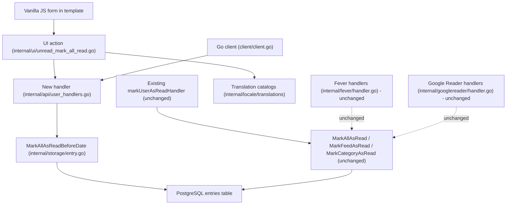
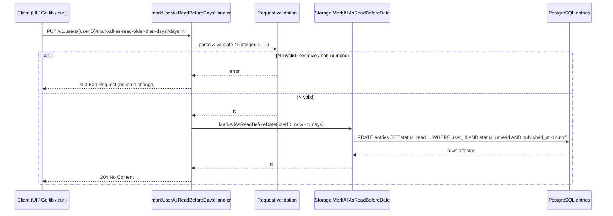

# Plan

The feature is a thin wiring layer on top of an already-shipped storage primitive. The
storage function `MarkAllAsReadBeforeDate` in `internal/storage/entry.go:523-544` already
performs the exact read-marking this spec needs (it runs
`UPDATE entries SET status=read, changed_at=now() WHERE user_id=$2 AND status=unread AND published_at < $3`),
so the design adds **no new SQL, no new column and no migration**. The delta is: (a) a new
HTTP handler that validates a `days` intake and converts it to a cut-off timestamp, added
as a sibling to `markUserAsReadHandler` in `internal/api/user_handlers.go:132` (which today
calls `MarkAllAsRead` in `internal/storage/entry.go:506-520`); (b) a new Go client method
beside `MarkAllAsRead` in `client/client.go:327-331`; (c) a new UI action beside
`markAllAsRead` in `internal/ui/unread_mark_all_read.go:13-20`; and (d) new keys in the
translation catalogs under `internal/locale/translations/` (e.g. `el_EL.json`). The
existing unfiltered paths — `markUserAsReadHandler`, `handleWriteGroups` in
`internal/fever/handler.go:521`, `handleWriteFeeds` in `internal/fever/handler.go:481-502`,
`markFeedAsReadHandler` in `internal/api/feed_handlers.go:162`, `markCategoryAsReadHandler`
in `internal/api/category_handlers.go:104`, and the Google Reader read handlers in
`internal/googlereader/handler.go` — are left byte-for-byte unchanged, which is what
preserves the Fever `before` contract (AC-9) and the unfiltered mark-all behaviour (AC-8).
The strict boundary semantics required by AC-4 fall out of the existing `published_at < $N`
predicate for free, provided the cut-off is `now - N days`.

Existing capability: MarkAllAsReadBeforeDate at internal/storage/entry.go:523-544

## Components

- **AgeMarkAllAsReadHandler** — Extends `internal/api/user_handlers.go` (`markUserAsReadHandler`)
  by adding a sibling handler `markUserAsReadBeforeDaysHandler`. It reads the required
  `days` integer, rejects anything negative or non-numeric with `response.JSONBadRequest`
  (`internal/http/response/json.go:55-74`) *before* touching storage (AC-7), computes the
  cut-off as `time.Now().Add(-N * 24h)`, resolves the caller via `request.UserID`
  (`internal/http/request/context.go:61-73`), delegates to the storage primitive and
  returns `response.JSON` / 204. It reuses the existing `request.QueryInt64Param` parsing
  pattern already used in `internal/api/entry_handlers.go` (`configureFilters`). This is
  the component that introduces the user-facing REST surface. (satisfies: AC-1, AC-2, AC-3,
  AC-4, AC-6, AC-7, AC-10, AC-11)
- **REST surface: `PUT /v1/users/{userID}/mark-all-as-read-older-than-days?days=N`** — the
  single new endpoint, registered alongside the existing `PUT /v1/users/{userID}/mark-all-as-read`
  route. The existing route and its signature are *not* modified (AC-8).
- **CutoffInvoker** — Extends `internal/storage/entry.go` (`MarkAllAsReadBeforeDate`, lines
  523-544). No storage delta is required: the existing per-user predicate and strict
  `published_at < $4` comparison already deliver AC-2/AC-3/AC-4/AC-5/AC-6/AC-10. The only
  work is invoking it with `userID` and the computed cut-off. The unfiltered sibling
  `MarkAllAsRead` (`internal/storage/entry.go:506-520`) is deliberately left untouched so
  its callers `markUserAsReadHandler` (`internal/api/user_handlers.go:132`) and
  `handleWriteGroups` (`internal/fever/handler.go:521`) keep working (AC-8).
  (satisfies: AC-2, AC-3, AC-4, AC-5, AC-6, AC-10)
- **GoClientMethod** — Extends `client/client.go` (`MarkAllAsRead`, lines 327-331, itself a
  thin wrapper over `MarkAllAsReadContext`). Adds `MarkAllAsReadOlderThanDays` as a sibling
  following the identical `withDefaultTimeout()` / `*Context` pattern (see
  `MarkFeedAsRead` at `client/client.go:749-753`), calling the new endpoint. No new shared
  model type is needed; `client/model.go` `Entry`/`Entries` are unchanged.
  (satisfies: AC-1, AC-2)
- **UIAction** — Extends `internal/ui/unread_mark_all_read.go` (`markAllAsRead`, lines
  13-20) by adding a sibling handler for the day-bounded action plus its template control
  and vanilla-JS handler. It posts the chosen N to the new endpoint and reloads. The
  existing `markAllAsRead` UI handler (which calls `MarkGloballyVisibleFeedsAsRead`) is
  untouched. (satisfies: AC-1, AC-12)
- **TranslationCatalogEntries** — Extends the existing locale catalogs, e.g.
  `internal/locale/translations/el_EL.json`; adds keys for the new action label, the `days`
  field label and the validation error message. No hardcoded user-facing string is added.
  (satisfies: AC-12)
- **ExistingIntegrationSurface (unchanged, verified)** — names the code the plan must *not*
  disturb: `handleWriteFeeds` (`internal/fever/handler.go:481-502`, Fever `before`
  parameter → `MarkFeedAsRead` at `internal/fever/handler.go:496`) and `handleWriteGroups`
  (`internal/fever/handler.go:510-541` → `MarkAllAsRead` and `MarkCategoryAsRead`), plus the
  Google Reader read handler (`internal/googlereader/handler.go:1205` →
  `MarkFeedAsRead`). No component changes them; they are asserted intact by tests.
  (satisfies: AC-8, AC-9)
- **TestSuite** — new unit tests for the handler (validation, cut-off arithmetic, boundary),
  storage-level tests reusing the `MarkAllAsReadBeforeDate` harness, and integration tests
  for the endpoint covering age boundary and two-user isolation. Extends the existing
  storage/handler test files in the same packages. (satisfies: AC-2, AC-3, AC-4, AC-5,
  AC-6, AC-7, AC-10, AC-11)

No component is marked **New**: the closest existing modules for each behaviour
(`markUserAsReadHandler`, `MarkAllAsReadBeforeDate`, `MarkAllAsRead`,
`unread_mark_all_read.go`) already implement the pattern, so every behaviour is an
extension of shipped code.

## Architecture diagram



## Sequence diagrams



```mermaid
sequenceDiagram
    participant U as User A
    participant API as New endpoint
    participant S as Storage
    participant DB as PostgreSQL entries

    U->>API: mark older than N days
    API->>S: MarkAllAsReadBeforeDate(userA, cutoff)
    S->>DB: UPDATE ... WHERE user_id = userA AND published_at < cutoff
    Note over DB: User B rows never match user_id predicate
    DB-->>S: rows affected (A only)
    S-->>API: nil
    API-->>U: 204; unread counts for A reflect change
```

## ADRs

- **Decision**: Reuse `MarkAllAsReadBeforeDate` (`internal/storage/entry.go:523-544`) as
  the sole persistence mechanism and add no SQL, column or migration. **Rationale**: it
  already implements exactly the per-user, strict-`<`, unread-only update the spec
  describes; the constitution requires migrations to go through
  `internal/database/migrations.go` only when schema changes, and no schema change is
  needed here. (satisfies: AC-2, AC-3, AC-4, AC-5, AC-6, AC-10)
- **Decision**: Add a *new* endpoint and handler rather than adding an optional `days`
  parameter to the existing `PUT /v1/users/{userID}/mark-all-as-read`. **Rationale**: the
  spec declares any change to the definition/parameters/responses of the existing
  mark-all-as-read contract out of scope, and the constitution makes those interfaces
  backward-compatible contracts. A separate route keeps the old one bit-identical.
  (satisfies: AC-8, AC-9)
- **Decision**: Compute the cut-off as `now - N days` and rely on the storage predicate's
  strict `published_at < cutoff` for boundary behaviour. **Rationale**: exactly-N-days-old
  entries compare equal to the cut-off and are therefore excluded, satisfying AC-4 without
  bespoke comparison logic. (satisfies: AC-2, AC-4, AC-6)
- **Decision**: Validate `days` in the HTTP handler and reject before any storage call.
  **Rationale**: guarantees "rejected without partial change" for negative/non-numeric
  input and keeps the storage layer free of presentation concerns. (satisfies: AC-7)
- **Decision**: Scope by `request.UserID(r)` and pass it through to the existing
  `user_id=$2` predicate. **Rationale**: reuses the storage layer's existing user isolation;
  no new authorization logic. (satisfies: AC-10)
- **Decision**: Route all new labels and error text through the translation catalogs
  (e.g. `internal/locale/translations/el_EL.json`). **Rationale**: the constitution
  forbids hardcoded user-facing strings. (satisfies: AC-12)
- **Decision**: Build no new dependency and no new frontend framework; the UI ships a
  vanilla-JS form control. **Rationale**: constitution's "Minimal Third-Party Dependencies
  and Vanilla Frontend"; the file stays embedded in the single binary. (satisfies: AC-12)

## Risks & mitigations

- **Risk**: Touching `MarkAllAsRead` or the Fever/Google Reader handlers would break
  existing clients (AC-8/AC-9). **Mitigation**: leave `MarkAllAsRead`
  (`internal/storage/entry.go:506-520`), `handleWriteFeeds`/`handleWriteGroups`
  (`internal/fever/handler.go:481-541`) and `internal/googlereader/handler.go:1205`
  untouched; add regression tests asserting the existing routes behave identically.
- **Risk**: Boundary off-by-one (AC-4) — an exactly-N-days-old entry wrongly marked.
  **Mitigation**: pin the cut-off to `now - N days` and assert the strict `<` predicate
  with an explicit exactly-N test.
- **Risk**: Partial writes on invalid input (AC-7). **Mitigation**: validate and reject in
  the handler before calling storage; storage itself is a single atomic `UPDATE`.
- **Risk**: Cross-user leakage (AC-10). **Mitigation**: rely on the existing `user_id`
  predicate; add a two-user integration test asserting user B is unaffected.
- **Risk**: Users routinely exercise global "mark all as read" through
  `markUserAsReadHandler` (`internal/api/user_handlers.go:132`) and the UI
  `markAllAsRead` (`internal/ui/unread_mark_all_read.go:13-20`); a careless refactor could
  redirect those to the new handler. **Mitigation**: keep the two handlers separate and add
  a test asserting the unfiltered path is unchanged.
- **Risk**: Untranslated strings shipped (AC-12). **Mitigation**: add every new string to
  `internal/locale/translations/*.json`; no literal text in the template/JS.
- **Risk**: Schema drift pressure. **Mitigation**: state explicitly that this change writes
  no new stored data, so `internal/database/migrations.go` is not touched.

## Constitution Compliance Check

| Principle | Status | Notes |
|---|---|---|
| Single Static Binary | pass | No new runtime dependency; new UI assets remain embedded via the existing `embed` setup. |
| PostgreSQL Is the Only Supported Database, Without an ORM | pass | Reuses existing parameterized SQL in `internal/storage/entry.go`; no ORM, no new migration. |
| Minimal Third-Party Dependencies and Vanilla Frontend | pass | No new Go deps; UI control is vanilla JS. |
| Backward-Compatible Interfaces and Integrations | pass | Existing mark-all/feed/category and Fever/Google Reader routes unchanged; feature is additive. |
| Test Coverage Is Mandatory | pass | Unit + storage + integration tests planned, including boundary and multi-user isolation. |
| Frugal Resource Usage and Polite Fetching | pass | Single `UPDATE`; no crawling or network fetching introduced. |
| Localized User-Facing Text | pass | All new strings go through the translation catalogs. |